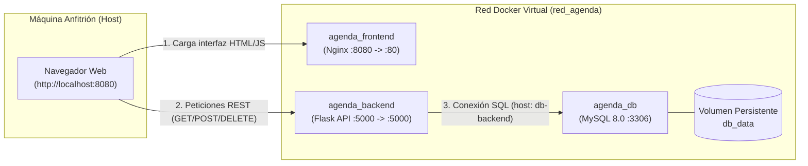

# Proyecto Docker Compose: Agenda de Contactos / Directorio Corporativo

Aplicación web distribuida en microservicios contenerizados utilizando **Docker Compose**, diseñada para demostrar el ciclo de vida, la orquestación, las redes virtuales, la persistencia y la interacción entre capas de un sistema web completo.

---

## 👥 Asignación de Roles Corporativos

| Rol Corporativo | Responsabilidad Principal | Entregable Clave |
| :--- | :--- | :--- |
| **Ingeniero DevOps / Infraestructura** | Orquestación general, redes virtuales, variables de entorno y persistencia. | `docker-compose.yml`, `.env`, redes y volúmenes |
| **Administrador de Bases de Datos (DBA)** | Modelo relacional, script DDL/DML y credenciales. | `database/database.sql` |
| **Ingeniero Backend** | API REST, lógica de negocio y conexión a la base de datos. | `backend/app.py`, `backend/Dockerfile` |
| **Ingeniero Frontend** | Interfaz web interactiva y consumo asíncrono de la API. | `frontend/index.html`, `frontend/Dockerfile` |

---

## 🏛️ Arquitectura del Sistema e Interacción en Docker



### 🔍 ¿Cómo interactúan los componentes en Docker?

1. **Resolución de Nombres por DNS Interno:**  
   En un entorno tradicional, el backend buscaría la base de datos en `localhost`. En Docker Compose, cada servicio recibe un nombre DNS interno. Por ello, Flask se conecta a `host="db-backend"`, y el motor de red de Docker redirige el tráfico automáticamente al contenedor de MySQL.

2. **Control de Ciclo de Vida y Salud (`depends_on` + `healthcheck`):**  
   MySQL tarda varios segundos en inicializar sus tablas. El `healthcheck` en `docker-compose.yml` verifica que MySQL esté completamente listo (`mysqladmin ping`). El servicio `backend` solo inicia cuando MySQL pasa a estado `healthy`, evitando errores de conexión al arrancar.

3. **Persistencia con Volúmenes (`db_data`):**  
   Los contenedores son efímeros por naturaleza. Al mapear el volumen `db_data:/var/lib/mysql`, los contactos que agregues seguirán existiendo aunque apagues, reinicies o destruyas los contenedores.

4. **Variables de Entorno Centralizadas (`.env`):**  
   Las contraseñas y nombres de base de datos se configuran en el archivo `.env`, manteniendo el código fuente libre de secretos sensibles.

---

## 📦 Gestión de Dependencias en Python: `requirements.txt` vs `pyproject.toml`

- **¿Qué es `pyproject.toml`?** Es el estándar moderno de empaquetado y gestión de proyectos en Python (definido en **PEP 518 y PEP 621**). Herramientas actuales como `uv`, `poetry` y versiones modernas de `pip` lo utilizan para centralizar metadatos y dependencias en un solo lugar.
- **¿Por qué usamos `requirements.txt` en el Dockerfile?** En entornos educativos y despliegues con Docker, `requirements.txt` sigue siendo el estándar universal debido a su simplicidad, rapidez y compatibilidad nativa con la caché de capas de Docker (`RUN pip install --no-cache-dir -r requirements.txt`).
- *En este proyecto se incluyen ambos archivos en la carpeta `backend/` para demostrar el cumplimiento del estándar clásico y las tendencias modernas de Python.*

---

## 📂 Estructura del Directorio

```
c:\Users\Erick\Downloads\Docker_project\
├── .env                          # Variables de entorno activas
├── .env.example                  # Plantilla de variables de entorno
├── docker-compose.yml            # Archivo principal de orquestación Docker
├── README.md                     # Documentación técnica
├── database/
│   └── database.sql             # Script SQL de creación y datos de prueba
├── backend/
│   ├── app.py                   # API REST en Flask con reintentos y os.getenv
│   ├── Dockerfile               # Imagen Docker para el backend
│   ├── requirements.txt         # Dependencias estándar para pip
│   └── pyproject.toml           # Especificación moderna PEP 621
└── frontend/
    ├── Dockerfile               # Imagen Docker para Nginx
    └── index.html               # Interfaz de usuario interactiva
```

---

## 🚀 Guía de Ejecución Paso a Paso

### 1. Iniciar Docker Desktop
Asegúrate de que la aplicación **Docker Desktop** esté abierta y ejecutándose en Windows.

### 2. Abrir Terminal en la Carpeta del Proyecto
Abre PowerShell o CMD y navega a la carpeta:
```bash
cd c:\Users\Erick\Downloads\Docker_project
```

### 3. Construir y Levantar los Contenedores
Ejecuta el siguiente comando para descargar imágenes, compilar el frontend y backend, y arrancar todos los servicios en segundo plano:
```bash
docker-compose up --build -d
```

### 4. Verificar el Estado de los Contenedores
Comprueba que los 3 servicios estén arriba (`Up`):
```bash
docker-compose ps
```
Deberás ver los tres contenedores:
- `agenda_db` (MySQL 8.0, estado `healthy`)
- `agenda_backend` (Flask en puerto 5000)
- `agenda_frontend` (Nginx en puerto 8080)

---

## 🌐 Pruebas y Validación

### Probar en el Navegador Web
1. Abre tu navegador e ingresa a:  
   👉 **`http://localhost:8080`**
2. Observarás la tabla con los **15 contactos iniciales** cargados automáticamente desde MySQL a través de la API Flask.
3. Ingresa un nuevo contacto en el formulario y haz clic en **Guardar Contacto**. Comprueba que aparece en la tabla al instante.
4. Utiliza el buscador en tiempo real para filtrar por nombre o departamento.
5. Puedes hacer clic en **Eliminar** para probar el endpoint `DELETE`.

### Probar la API Backend Directamente
- **Comprobación de Salud:**
  ```bash
  curl http://localhost:5000/api/health
  ```
  *Respuesta esperada:* `{"database":"conectada","host":"db-backend","status":"OK"}`

- **Consultar Contactos:**
  ```bash
  curl http://localhost:5000/api/contactos
  ```

### Probar la Persistencia de Datos
1. Detén los contenedores:
   ```bash
   docker-compose down
   ```
2. Vuelve a levantarlos:
   ```bash
   docker-compose up -d
   ```
3. Recarga `http://localhost:8080` en tu navegador:  
   *Los contactos nuevos que agregaste siguen intactos gracias al volumen `db_data`.*

---

## 🛑 Detener el Proyecto
Para detener y retirar los contenedores preservando los datos:
```bash
docker-compose down
```
*(Si en algún momento deseas eliminar también la base de datos para empezar de cero, puedes agregar el flag `-v`: `docker-compose down -v`).*
